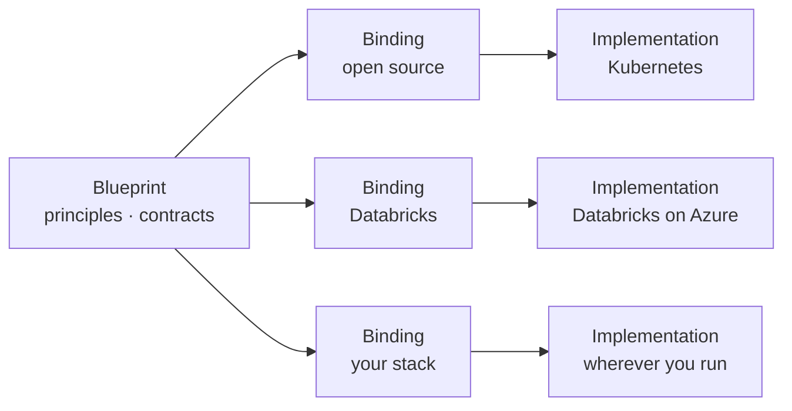

  <picture>
    <source media="(prefers-color-scheme: dark)" srcset="https://raw.githubusercontent.com/LumenOSS/.github/main/assets/banner-dark.svg">
    
  </picture>

  <a href="#vision">Vision</a> ·
  <a href="#mission">Mission</a> ·
  <a href="#scope">Scope</a> ·
  <a href="#what-we-are-building">Projects</a> ·
  <a href="#how-we-work">How we work</a> ·
  <a href="#follow-along">Follow along</a>

## Vision

**Every education system can own, understand and trust the platform that
holds its learners', teachers' and schools' data.**

## Mission

We publish open, vendor-neutral blueprints for education management
information systems (EMIS). Each blueprint is a governed data platform
written as testable contracts, with reference implementations on open
source and on commercial platforms. Ministries and school systems can build
them anywhere, prove they conform, and keep control of what they run.

## Scope

LumenOSS works on education data only. Everything we publish is built
around the resources an EMIS holds: learners, schools, teachers and staff,
enrolment, attendance, assessment, and the indicators reported from them.
We do not take on other sectors.

We focus here because education data is personal, long-lived and spread
across many systems, and because ministries are often asked to choose
between a vendor's platform and building their own from scratch. Either
way, the knowledge of how it works tends to sit with a few people. We think
there is a third option: an open design that any ministry or school system
can read, build and check.

## What we are building

| Project | What it is | Status |
| --- | --- | --- |
| **data-platform-blueprint** | The architecture of a governed EMIS data platform: principles, 34 capabilities with testable contracts, C4 diagrams, decision records, and research-backed patterns for backfill and migration | In development; public at first release |
| **data-platform-oss** | A reference implementation built only from open-source components, on any Kubernetes cluster | Planned |
| **data-platform-databricks** | A reference implementation on Databricks, using open table formats and open-source tooling where they fit | Planned |

The blueprint stays the same; implementations vary. Each implementation
states which components it uses for each capability and shows the evidence
that it meets every clause, or writes down where it does not and why.

## How we work

- **Open by default.** Designs, decisions and their reasons are public, so
  anyone accountable for a system can see how it works.
- **Contracts, not claims.** Every requirement says how it is tested.
  Conformance is evidence, not a promise.
- **Vendor-neutral.** No architecture depends on one product. Where open
  source cannot match a commercial platform, we say so plainly and name the
  control that stands in.
- **Privacy by design.** Learners' data is protected by role, scope and
  sensitivity, and leaves a platform only de-identified, approved and
  recorded.
- **Built to be handed over.** Everything is code, every task is one
  command, and authority belongs to roles, not to individuals.
- **Measured, not assumed.** We cite primary sources, mark what we could
  not verify, and record what went wrong so others need not repeat it.

## Follow along

We are preparing our first public release. Watch this organisation to see
it land. All projects are licensed under the
[Apache License 2.0](https://www.apache.org/licenses/LICENSE-2.0).

Lumen: a unit of light. We aim to shed some on the systems that hold education data.

